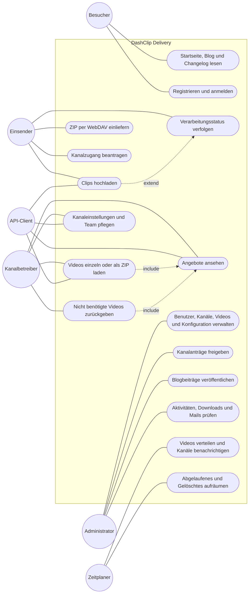

# Anwendungsfälle

Mermaid kennt kein eigenes Anwendungsfalldiagramm, deshalb sind Akteure als Kreise und Anwendungsfälle
als abgerundete Knoten innerhalb der Systemgrenze dargestellt.

| Akteur          | Zugang                                                         |
|-----------------|----------------------------------------------------------------|
| Besucher        | Öffentliche Website ohne Anmeldung                             |
| Einsender       | Bereich für Einsender, Rolle `panel_user`                      |
| Kanalbetreiber  | Bereich für Einsender mit Rolle `channel_operator` oder signierter Angebotslink aus der Mail |
| Administrator   | Verwaltungsbereich, Rolle `super_admin`                        |
| API-Client      | REST-API `v1` mit OAuth-Token und Scopes                       |
| Zeitplaner      | Geplante Befehle, siehe [Zeitplan](09-zeitplan.md)             |
