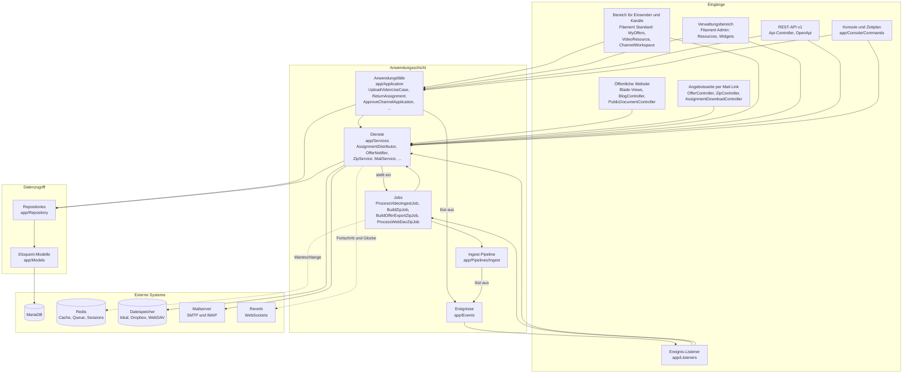
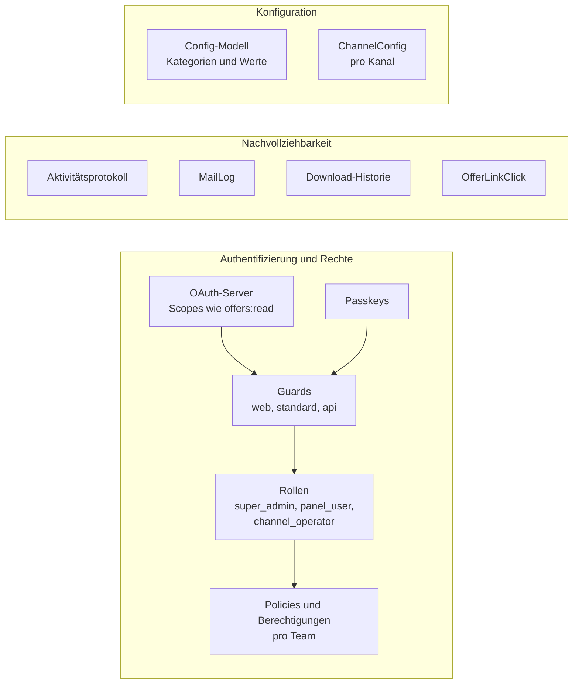

# Komponenten

Die Anwendung ist in Schichten aufgebaut. Eingänge (Controller, Bereiche, Befehle, Listener) rufen
Anwendungsfälle und Dienste auf, die über Repositories auf die Modelle zugreifen. Lange Arbeiten laufen
als Jobs in der Warteschlange.

## Querschnittskomponenten

