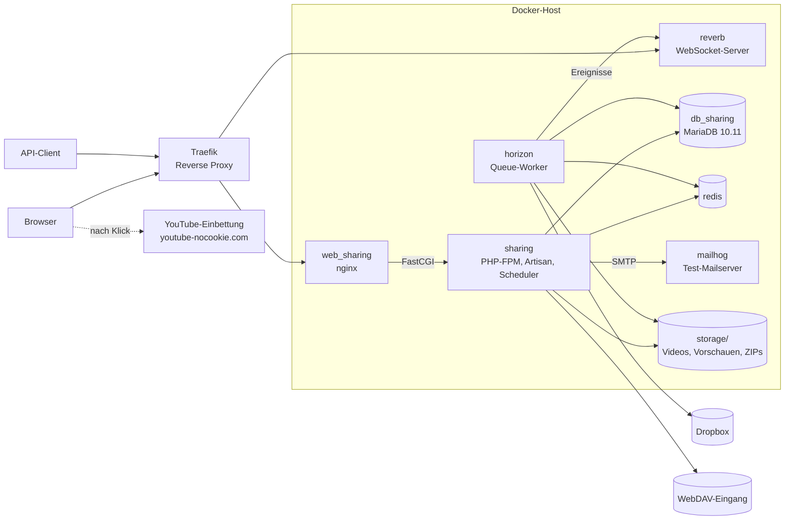

# Verteilung

Das Diagramm zeigt die Container aus `docker-compose.yml` und ihre Verbindungen. Die Produktion wird per
Deployer ausgerollt (siehe [Deployment](../deployment.md)) und besteht aus denselben Rollen.

| Container     | Aufgabe                                                                  |
|---------------|--------------------------------------------------------------------------|
| `web_sharing` | Liefert statische Dateien aus `public/` und leitet PHP an `sharing` weiter |
| `sharing`     | Anwendung, Artisan-Befehle, Tests                                        |
| `horizon`     | Arbeitet die Warteschlangen ab: Ingest, ZIP-Bau, Exporte, Mails          |
| `reverb`      | Schickt ZIP-Fortschritt und Benachrichtigungen live an den Browser       |
| `db_sharing`  | Datenbank                                                                |
| `redis`       | Cache, Warteschlangen, Sessions, Download-Fortschritt                    |
| `mailhog`     | Fängt lokal alle ausgehenden Mails ab                                    |
