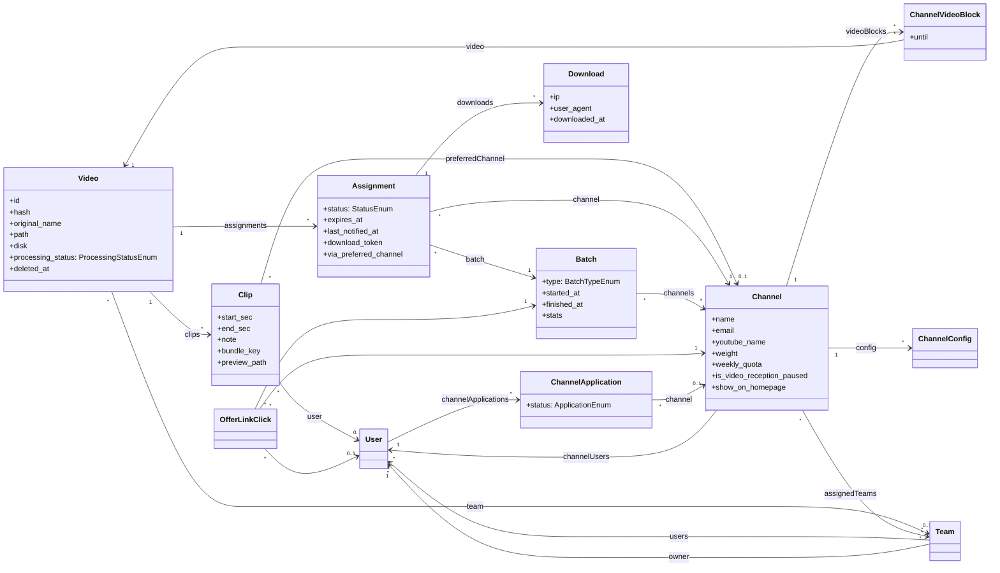
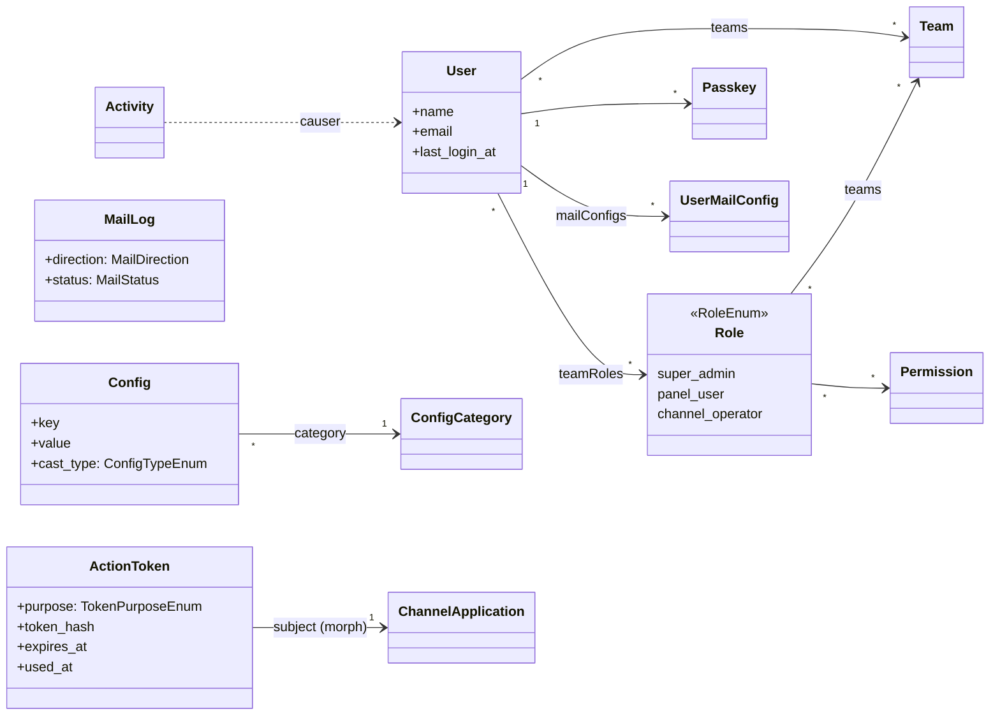
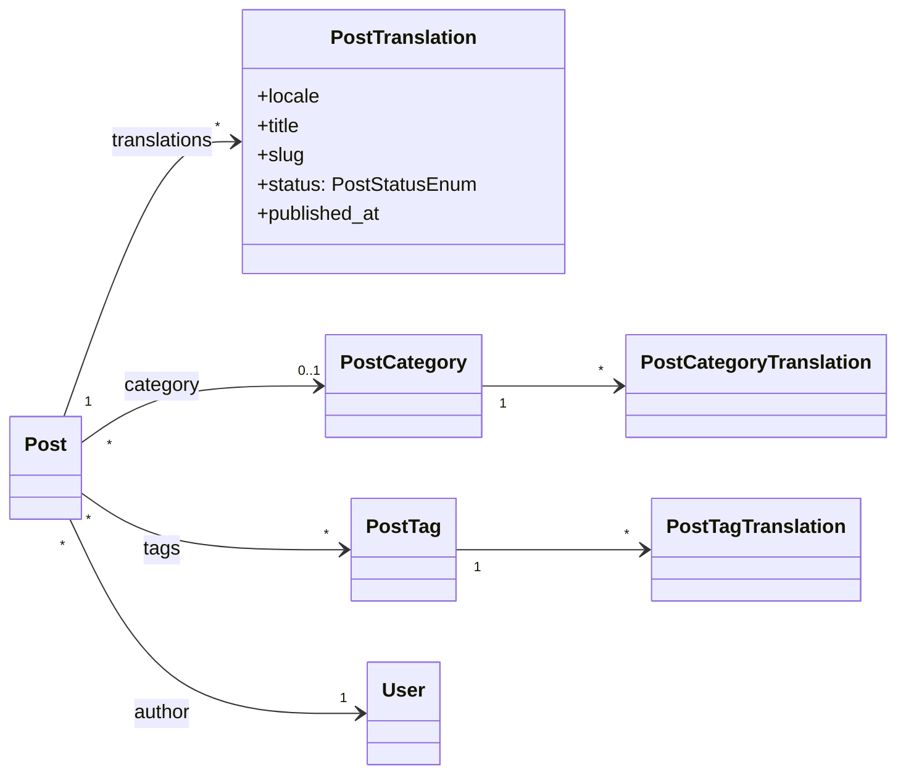

# Domänenmodell

Ein Angebot heißt im Code `Assignment`: ein Video, das einem Kanal in einem Lauf (`Batch`) angeboten
wird.

## Kern: Videos, Kanäle und Angebote

## Benutzer, Rechte und Kommunikation

## Blog

Die Attributlisten zeigen die fachlich wichtigen Felder, nicht jede Spalte.
