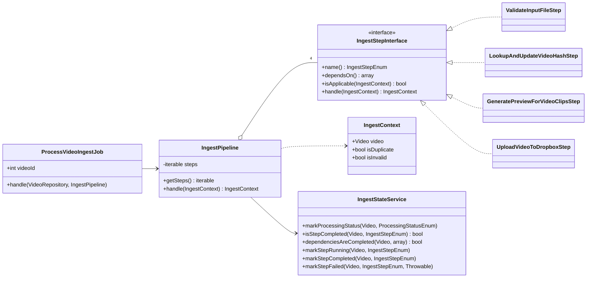
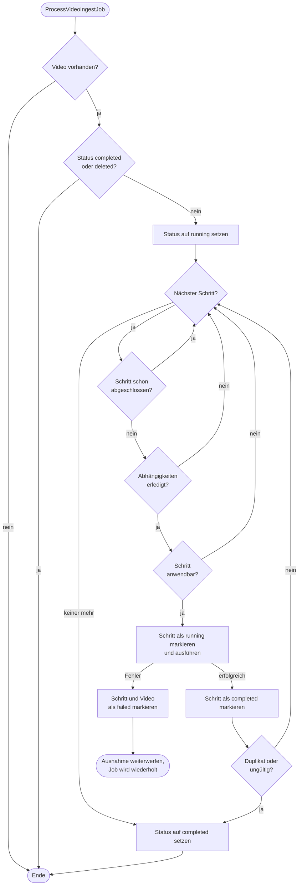

# Ingest-Pipeline

Nach dem Upload verarbeitet `ProcessVideoIngestJob` jedes Video über eine Pipeline aus Schritten. Die
Schritte werden im `IngestServiceProvider` mit dem Tag `ingest.step` registriert. Jeder Schritt meldet
seinen Stand an den `IngestStateService`, damit ein abgebrochener Lauf an der richtigen Stelle
weitermacht.

## Struktur

## Ablauf eines Laufs

| Schritt                          | Aufgabe                                                      |
|----------------------------------|--------------------------------------------------------------|
| `ValidateInputFileStep`          | Prüft, ob die Datei ein gültiges Video ist                   |
| `LookupAndUpdateVideoHashStep`   | Berechnet den SHA-256-Hash und erkennt Duplikate             |
| `GeneratePreviewForVideoClipsStep` | Erzeugt die Vorschau für jeden Clip mit FFmpeg             |
| `UploadVideoToDropboxStep`       | Lädt das Video in den Zielspeicher hoch                      |

Hängen gebliebene oder fehlgeschlagene Läufe stellen die Befehle unter
`app/Console/Commands/VideoProcessing` alle 15 Minuten neu ein.
