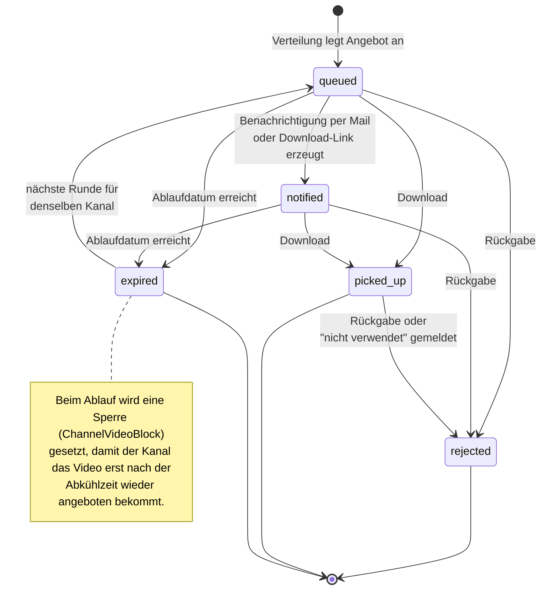
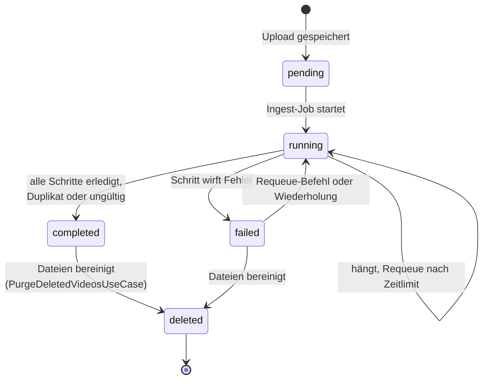
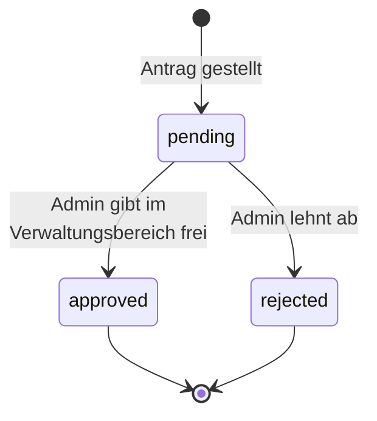
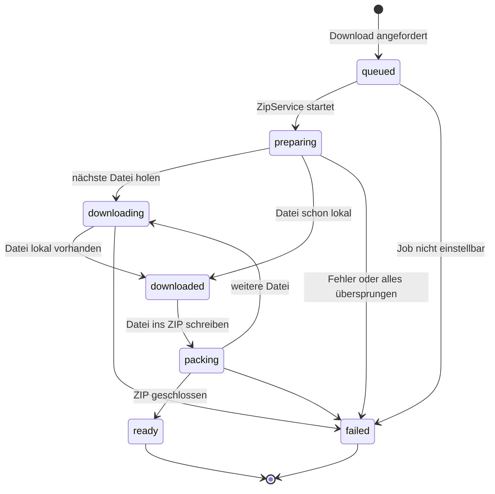
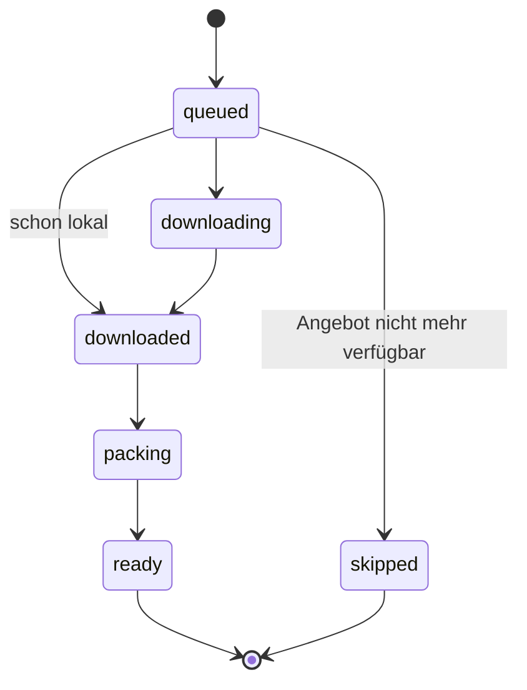

# Zustände

## Angebot (`Assignment.status`, `StatusEnum`)

`queued` und `notified` gelten als bereit (`getReadyStatus`). `queued`, `notified` und `picked_up`
lassen sich zurückgeben (`getReturnableStatuses`).

## Videoverarbeitung (`Video.processing_status`, `ProcessingStatusEnum`)

## Kanalantrag (`ChannelApplication.status`, `ApplicationEnum`)

## ZIP-Erstellung (`DownloadStatusEnum`, im Download-Cache)

Gesamtstatus des Auftrags:

Status je Datei:

## Lauf (`Batch.type`, `BatchTypeEnum`)

Ein `Batch` hat keinen Lebenszyklus, sondern einen Typ: `assign` (Verteilung), `notify`
(Benachrichtigung), `ingest`, `remove` und `api`.
