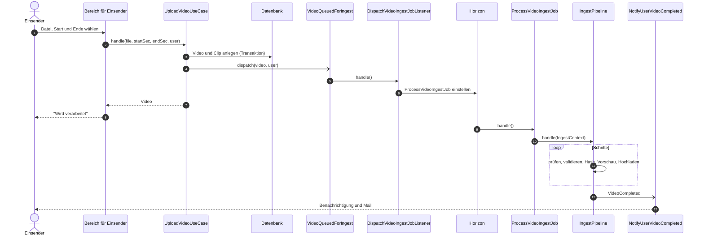
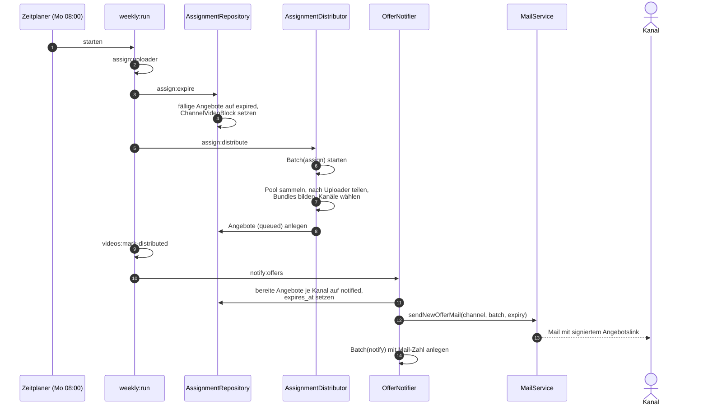
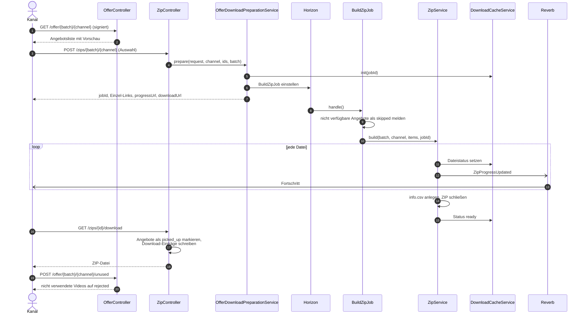
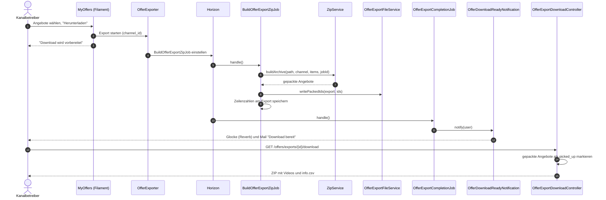
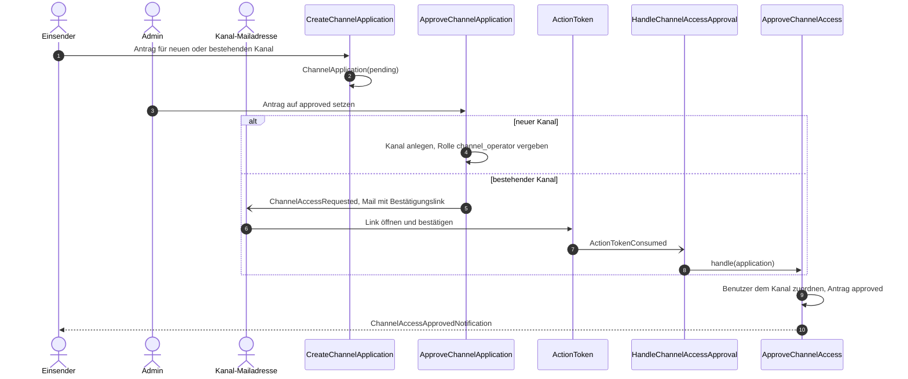
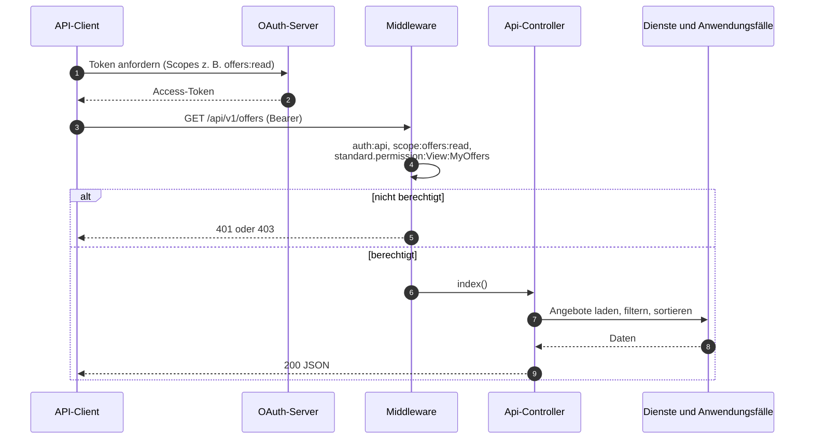

# Abläufe

## Upload und Verarbeitung

WebDAV-Uploads laufen über `ZipUploadedListener` und `ProcessWebDavZipJob`: das ZIP wird entpackt,
und jede enthaltene Datei geht in denselben Ablauf.

## Wochenlauf: verteilen und benachrichtigen

## Angebotsseite aus der Mail

## Export in "Meine Angebote"

## Kanalzugang beantragen und freigeben

## REST-API mit OAuth

