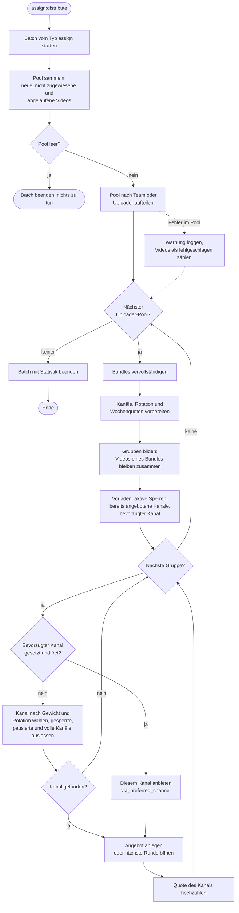

# Verteilung der Videos

Aktivitätsdiagramm zu `AssignmentDistributor::distribute()`.

Ein Angebot wird innerhalb einer Transaktion angelegt, die das Video sperrt. Wurde das Video
inzwischen gelöscht, bricht die Anlage mit `VideoUnavailableForOfferException` ab.
